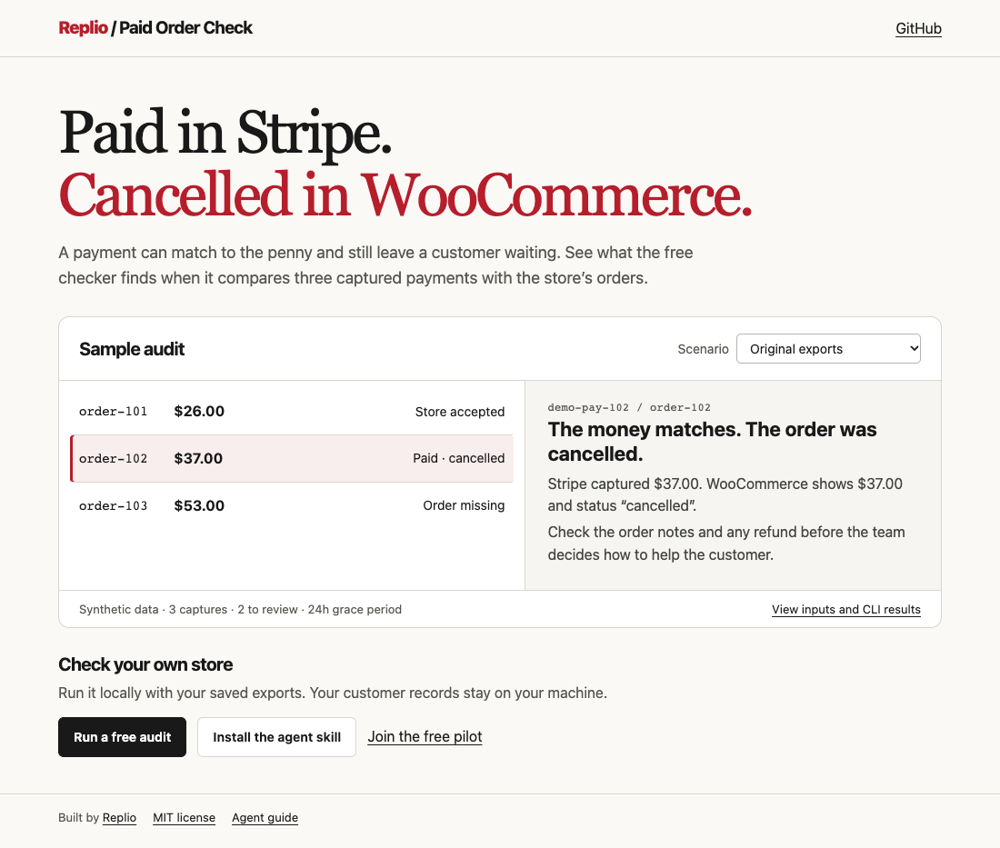

# Paid Order Check

**Which Stripe payments have no WooCommerce order?** Paid Order Check is a free, open-source reconciliation CLI and agent skill for finding paid orders that are missing, cancelled, failed, or still pending. It starts with captured payments and reads two local files. The JSON report gives an agent the references to investigate. No account, API key, or package dependencies are needed for the audit.

## Try the demo

[Explore the three-payment sample in your browser](https://chaseakub.github.io/paid-order-check/). Select a payment to see the evidence. Switch scenarios to see how the findings change when a missing order arrives or a payment is refunded. The page uses synthetic inputs and reports produced by the Python checker.

[](https://chaseakub.github.io/paid-order-check/)

Python 3.9 or later is required. From a checkout of this repository, run:

```sh
python3 skills/paid-order-audit/scripts/check_orders.py demo
```

The three synthetic captures include one completed order, one paid but cancelled order, and one payment missing from the order export. Only the last two need review. The checker never contacts a payment processor, changes an order or issues a refund.

## Install the agent skill

```sh
npx skills add chaseakub/paid-order-check --skill paid-order-audit
```

The skill also has a [public directory page](https://skills.sh/chaseakub/paid-order-check/paid-order-audit).

Then ask your agent: **“Audit my captured Stripe payments against my WooCommerce orders. Which paid orders were cancelled or are missing?”** The installed skill includes the executable checker, example exports, and the field definitions. The demo works offline after installation.

## Check a store

Use a single live store and processor account. Pick a completed historical period and include enough order history on either side to cover checkout delays. A complete capture export and a reliable shared order or payment reference matter more than the size of the sample.

```sh
python3 skills/paid-order-audit/scripts/check_orders.py audit \
  --payments payments.csv --orders orders.csv \
  --as-of 2026-11-23T00:00:00Z --grace-hours 24
```

Use the timestamp of your snapshots and the store's normal delay in hours. The input CSVs contain normalized fields. Use the [field definitions](skills/paid-order-audit/references/exports.md) or the [offline converter for native Stripe and WooCommerce exports](skills/paid-order-audit/references/native-exports.md). For a real audit, the merchant can keep all files on their own machine.

`no_order_in_export` means that the checker could not find the expected order in the supplied records. Verify the account, date coverage and references before acting. Refunded or disputed payments, ambiguous IDs, unmatched totals, and unsupported statuses are reported for review. A processing or completed order counts as accepted by the store. Shipment or delivery requires separate evidence.

## Free pilot

Agencies and merchants can run and rerun the audit for free. For help with a first audit or a result, [email Chase about a private pilot](mailto:chase@repliohq.com?subject=Private%20Paid%20Order%20Check%20pilot&body=Hi%20Chase%2C%20I%27d%20like%20to%20try%20a%20free%20audit%20on%20one%20store.%20What%20should%20I%20prepare%3F). Your store platform is enough to get started. You can also [share aggregate feedback publicly on GitHub](https://github.com/chaseakub/paid-order-check/issues/new?template=pilot.yml). Keep customer details, merchant exports, and transaction identifiers on your machine.

## Why check both sides?

A merchant reported that Stripe acknowledged both webhooks but WooCommerce cancelled the paid order seven hours later. Another developer reported captured payments without corresponding orders in a Medusa production store. The MIT-licensed Payment Reconciliation Helper offers detailed accounting checks. This project focuses on the operational state of the order that the customer expects to receive. [WooCommerce report](https://github.com/woocommerce/woocommerce-gateway-stripe/issues/5691#issuecomment-5287986604) · [Medusa report](https://github.com/medusajs/medusa/issues/12790#issuecomment-3206888903) · [Payment Reconciliation Helper](https://github.com/VsevaTech/payment-reconciliation-helper)

MIT licensed. Built by [Replio](https://www.repliohq.com).
